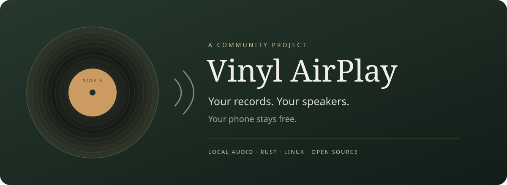

<div align="center">



**Your records. Your speakers. Your phone stays free.**

A local-first AirPlay sender for live audio, written in Rust.


[Get started](#get-started) · [Français](docs/README.fr.md) · [Compatibility](docs/COMPATIBILITY.md) · [Contribute](CONTRIBUTING.md) · [Roadmap](ROADMAP.md)

</div>

---

Connect a turntable's **line-level output** to a Linux audio input. Choose your
HomePod from the web interface, then let Vinyl AirPlay connect when music starts
and release the speaker after silence.

The phone is a remote control. It does not carry the audio.

```text
Turntable → phono preamp* → stereo line input → Linux → AirPlay → HomePod
                                                ↑
                                         local web control
```

*Only needed when the turntable does not already provide a line-level output.*

## What you can do

- **Play live audio** to discovered HomePod and HomePod mini receivers.
- **Connect on sound**, then disconnect after a configurable silence period.
- **Control speakers from a browser**: selection, playback, speaker volume,
  fixed input gain and requested scheduling delay.
- **See the input**: stereo meters, peaks and a real twelve-band spectrum.
- **Identify records optionally**, with track information and album artwork.
- **Keep streaming local**: no project account, subscription or hosted service.

Product images are selected from discovered model and color metadata when
available. Recognition and external images require Internet access; audio
streaming and basic control do not.

## Community alpha — please read first

This is a working personal project being made portable, **not a finished consumer
appliance**. Playback has been heard on physical HomePod and HomePod mini hardware
from Linux x86-64 and ARM64 hosts. Other receivers remain unverified.

- Audio is stereo PCM, **16-bit / 44.1 kHz**, without lossy encoding in this path.
- A requested delay is **not** a measured turntable-to-speaker latency.
- Two independent receivers have been exercised; long-term synchronization and
  Apple-configured stereo pairs are not yet certified by this project.
- The first fraction of a track can be missed while automatic connection starts.
- Native iPhone/Home volume controls may be unavailable; the web volume control
  uses the existing sender session.
- Raspberry Pi is a target for community validation, **not yet a tested release**.
- TV mirroring and experimental hardware drivers are outside this first repository.

See the [compatibility matrix](docs/COMPATIBILITY.md) before buying hardware.

## Get started

You need Linux, Rust/Cargo, `alsa-utils`, Python 3.10+ for the optional web launcher,
and an AirPlay receiver on the same local network. Recognition also needs `curl`
and the optional fingerprint helper.

```sh
git clone https://github.com/bastiencantet/vinyl-airplay.git
cd vinyl-airplay
cargo build --release --locked

# Find your audio input and receivers.
arecord -L
./target/release/vinyl-airplay discover --seconds 5
```

**Direct playback**, using the actual device and address discovered on your LAN:

```sh
./target/release/vinyl-airplay stream \
  --alsa-device 'plughw:CARD=USB,DEV=0' \
  --target 192.168.50.20:7000 \
  --auto-connect --latency-ms 250
```

**Web control**, on the same Linux host:

```sh
python3 scripts/serve-web.py --alsa-device 'plughw:CARD=USB,DEV=0'
```

Open **http://127.0.0.1:8787/**. Select a discovered speaker, apply, then start.
Playback and recognition start disabled on a fresh installation.

For a phone on the same trusted Wi-Fi, use the host's actual private IPv4:

```sh
python3 scripts/serve-web.py \
  --alsa-device 'plughw:CARD=USB,DEV=0' --listen 192.168.50.10
```

Open `http://192.168.50.10:8787/` from your phone. This permits trusted LAN users
to control playback. **Do not forward this port to the Internet.** The controller
itself stays on loopback and its token is not sent to the browser.

No Kubernetes, root daemon, kernel changes or cloud account are required.
For wiring, recognition and troubleshooting, read the [setup guide](docs/SETUP.md).

## Help make it dependable

The most valuable contribution right now is a reproducible compatibility report:
Linux version, CPU architecture, audio interface, receiver model and firmware,
requested delay, session duration, and what you actually heard.

Do not upload recordings or unredacted discovery dumps. Use the GitHub issue
forms and read [CONTRIBUTING.md](CONTRIBUTING.md).

```sh
cargo fmt --check
cargo clippy --locked --all-targets -- -D warnings
cargo test --locked
```

Protocol emulators test authentication, encryption, timing, retransmission and
clean teardown without real speakers. They cannot prove acoustic latency or
long-session audio quality. See [development](docs/DEVELOPMENT.md).

## License and independence

[GPL-3.0-or-later](LICENSE). The optional SongRec-derived fingerprint helper keeps
its upstream attribution and license. See [NOTICE](NOTICE).

Independent community software. Not affiliated with Apple. Receiver software
updates may affect compatibility. No certified AirPlay compatibility or complete
implementation of Apple's protocols is claimed.
